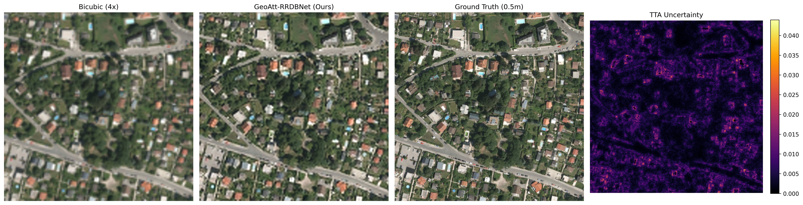

# GeoAtt-RRDBNet: 4x Satellite Imagery Super-Resolution with Uncertainty Quantification

A PyTorch super-resolution pipeline for 4x upscaling of urban satellite imagery (2.0m → 0.5m) featuring **Residual-in-Residual Dense Blocks with Channel & Spatial Attention (GeoAtt-RRDBNet)**, spectral-spatial loss optimization, seamless overlapping GeoTIFF inference, and **Test-Time Augmentation (TTA) epistemic uncertainty estimation**.

## Key Features
* **Zero-Leakage Geographic Split:** Trained on 7 cities (252 tiles), validated on 2 cities (72 tiles), and evaluated exclusively on an unseen city (`vienna`, 36 tiles).
* **Spectral-Spatial Loss:** Combines L1 reconstruction loss with Spectral Angle Mapper (SAM) loss (`sam_weight=0.1`) to preserve radiometric fidelity alongside sharp structural recovery.
* **Fast Windowed I/O:** Uses `rasterio.windows.Window` patch loading to eliminate full-tile disk bottlenecks (~4x training speedup).
* **Seamless GeoTIFF Export & Uncertainty:** Overlapping reflection-padded tiled inference (`pad=16` LR pixels) eliminates tile-seam artifacts while preserving CRS (`EPSG:31256`) and exact `0.5m` spatial resolution.

## Quantitative Results (`vienna` Unseen Test Split — 36 Tiles)

| Model | Training Steps | PSNR (↑) | SSIM (↑) | RMSE (↓) | SAM (↓) | ERGAS (↓) |
| :--- | :---: | :---: | :---: | :---: | :---: | :---: |
| **Bicubic Baseline** | — | 24.20 dB | 0.6718 | 0.0623 | **0.87°** | 3.44 |
| **GeoAtt-RRDBNet** *(initial)* | 480 | 24.42 dB | 0.6990 | 0.0607 | 1.43° | 3.35 |
| **GeoAtt-RRDBNet (Ours)** | 3,150 | **25.22 dB** | **0.7339** | **0.0554** | 1.10° | **3.06** |
| **Gain vs. Bicubic** | — | **+1.02 dB** | **+0.0621** | **-0.0069** | +0.23° | **-0.38** |

## Model Complexity & Inference Speed
* **Total Parameters:** `8,791,643` (8.79M)
* **Checkpoint Size:** `35.28 MB`
* **Inference Latency:** `384.84 ms` per `256×256 → 1024×1024` tile on an NVIDIA T4 GPU

## Quick Start

### 1. Train
```bash
python train.py \
  --train_lr path/to/LR_2m \
  --train_hr path/to/HR_0.5m \
  --val_lr path/to/LR_2m \
  --val_hr path/to/HR_0.5m \
  --train_cities austin bellingham bloomington chicago innsbruck kitsap tyrol-w \
  --val_cities sfo tyrol-e \
  --out_dir runs/geoatt_rrdb_3k \
  --sam_weight 0.1 --epochs 50 --batch_size 16

### 2.Evaluate
```bash
python evaluate.py \
  --checkpoint runs/geoatt_rrdb_3k/best.pth \
  --test_lr path/to/LR_2m \
  --test_hr path/to/HR_0.5m \
  --cities vienna

### 3.Seamless GeoTIFF Inference + TTA Uncertainty
```bash
python predict.py \
  --checkpoint runs/geoatt_rrdb_3k/best.pth \
  --input_tif path/to/LR_2m/vienna1.tif \
  --output_sr runs/geoatt_rrdb_3k/vienna1_sr.tif \
  --output_unc runs/geoatt_rrdb_3k/vienna1_unc.tif \
  --tile_size 128

## Visual & Engineering Proofs

### 4× Super-Resolution & Epistemic Uncertainty (`vienna1`)


### Quantitative Performance & Engineering Optimizations


* **Full Per-Tile Metrics (36 Unseen Vienna Tiles):** [`results/vienna_per_tile_proof.csv`](results/vienna_per_tile_proof.csv)
* **Complete Technical Report:** [`docs/GeoAtt_RRDBNet_Project_Report.docx`](docs/GeoAtt_RRDBNet_Project_Report.docx)